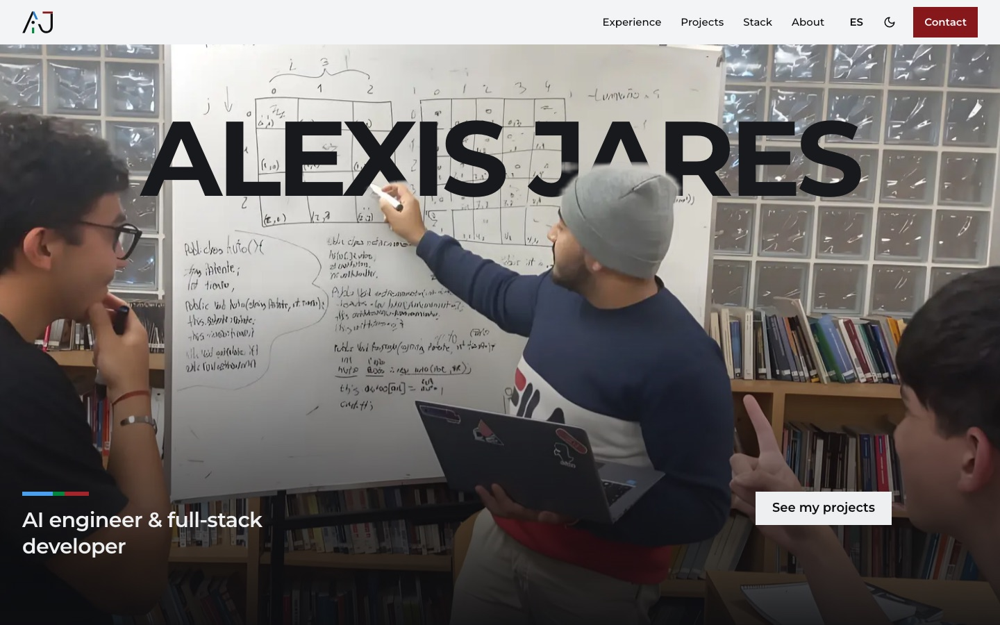
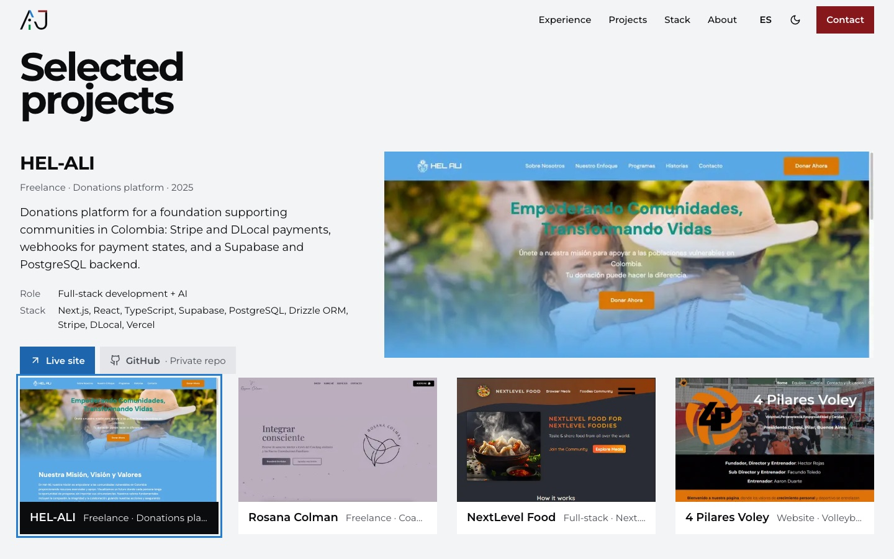
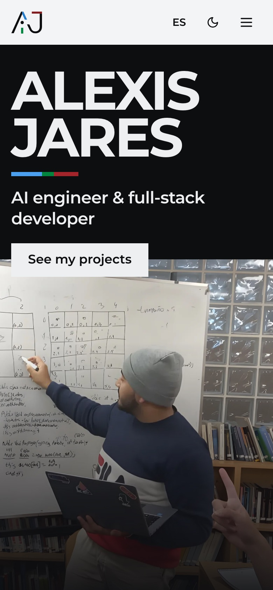
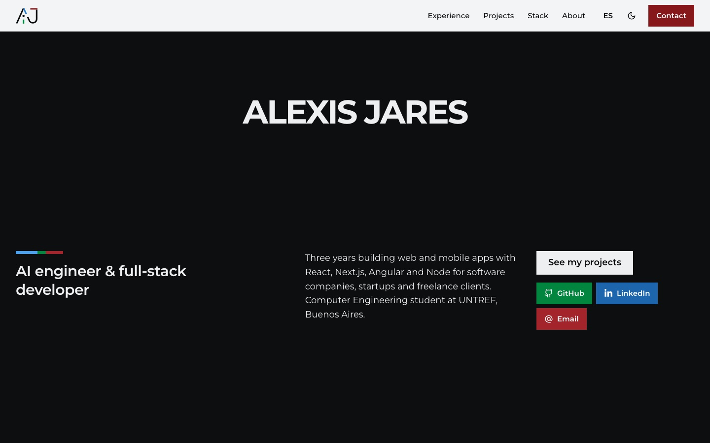

# Alexis Jares · Portfolio

AI engineer and full-stack developer based in Buenos Aires. This repository contains the source of my portfolio site.

**Live site: [alexisjares.com.ar](https://www.alexisjares.com.ar)** · [LinkedIn](https://www.linkedin.com/in/alexis-jares-b70857235) · [GitHub](https://github.com/KZ211) · [alexis.jares12@gmail.com](mailto:alexis.jares12@gmail.com)



## For recruiters

The site is written for a one-minute read and holds the same information as my CV:

- **Experience:** HEL-ALI (freelance, 2025 to now), Anfibia (full-stack, semi senior), and UTN's e-learning centre (frontend + AI).
- **Shipped projects:** each one links to its live site and its code, or says why the code is not public (private client repo, no-code build).
- **Stack:** every tool is listed next to the jobs and projects where I used it.
- **Contact:** email or LinkedIn. There is no form or backend; the message opens in your own mail app.

It is available in English and Spanish, with light and dark themes.

| Projects, previewed on hover or keyboard focus | Phone layout |
|---|---|
|  |  |

## For engineers

**Stack:** Next.js 14 (App Router), React 18, plain JavaScript, Tailwind CSS. The only runtime dependencies are `next`, `react`, `react-dom`, `react-icons` and `sharp`. All motion is CSS plus a few `requestAnimationFrame` loops; there are no animation or scroll libraries.

What is worth a look:

- **Layered scroll hero** (`app/sections/home.js`). One scroll progress value is turned into eased phases written as CSS custom properties (`--walk`, `--dim`, `--settle`…), and the planes (photo, cut-out people, name, copy) read them in `globals.css`. Hairlines trace the matrix drawn on the whiteboard, then open into the copy row. The name starts in marker ink and turns white as the board dims; the white copy is drawn by CSS (`content: attr(data-text) / ''`) so screen readers still hear the name once.
- **Projects stack** (`app/components/projects/projectStack.js`). The real screenshots float as a tilted stack and land as a row while the stage is pinned. Pointing at a card opens its preview. A keyboard user can Tab from a card into its repo and live links and on to the next card; Escape closes the preview. Focusing or clicking before the row has landed jumps straight to the landed state.
- **Contact slabs** (`app/components/contact/socialSlabs.js`). The three bars of the AJ logo are built as CSS 3D boxes that open as the section scrolls in. The slabs are the links themselves.
- **Content as data.** Jobs, projects, stack and profile live in `app/data/`; UI copy lives in `app/i18n/translations.js` as `en`/`es` pairs. The stack section works out where each tool was used from the jobs and projects, so it can't drift from them.
- **Accessibility.** Every moving part has a `prefers-reduced-motion` fallback that shows the finished state. Animation loops only run while their section is on screen. Touch targets are at least 44px, and text contrast was checked in both themes. The saved theme is applied by an inline script before first paint, so there is no flash.

<details>
<summary>The hero once the board has dimmed</summary>



</details>

## Run it locally

Requires Node 18.17 or later.

```bash
npm install
npm run dev     # http://localhost:3000
npm run lint    # ESLint (next/core-web-vitals)
npm run build   # production build
```

## Structure

```
app/
  page.js             composes the sections in order
  sections/           home, experience, projects, stack, about, blog, contact, footer
  components/         navbar, projects (stack, showcase, details), contact slabs, ui (buttons, logo, reveal)
  data/               experience.js, projects.js, stack.js, profile.js
  i18n/translations.js
  context/            language and theme providers
globals.css           colour tokens (light and dark) and all scroll-driven motion
public/images/        photos and project screenshots
```

To add a project, append an object to `app/data/projects.js`. The stack, the preview and the phone list all read from it. Links take `active: false` plus a `note` (for example "Private repo") to render as a disabled button that gives the reason.

---

**En español:** este es el código de mi portfolio. Soy IA engineer y desarrollador full-stack en Buenos Aires. El sitio está en inglés y español: [alexisjares.com.ar](https://www.alexisjares.com.ar).
